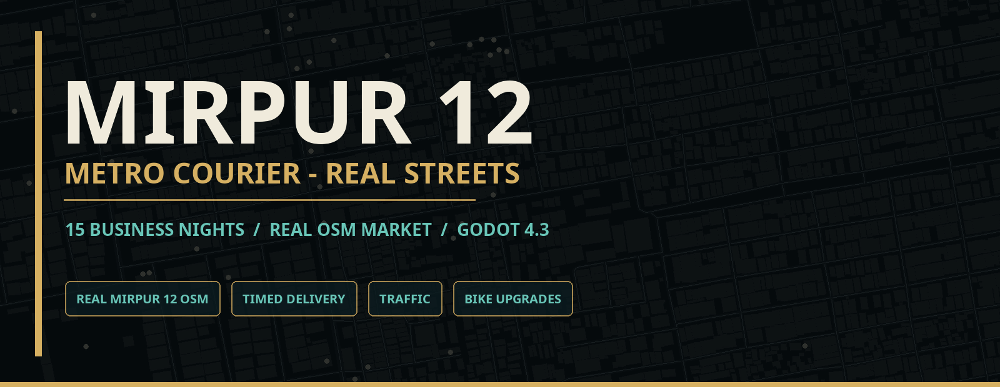
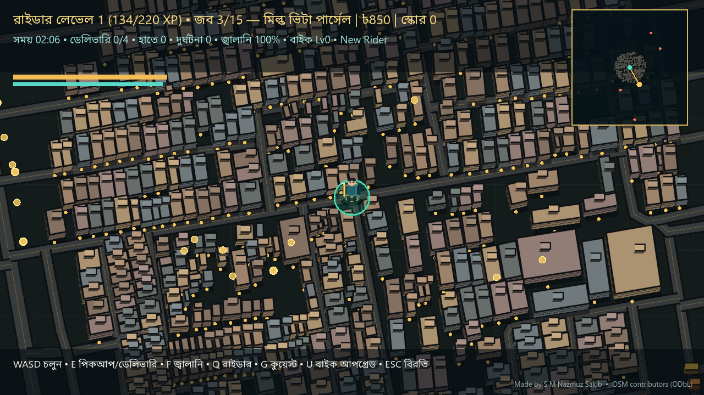
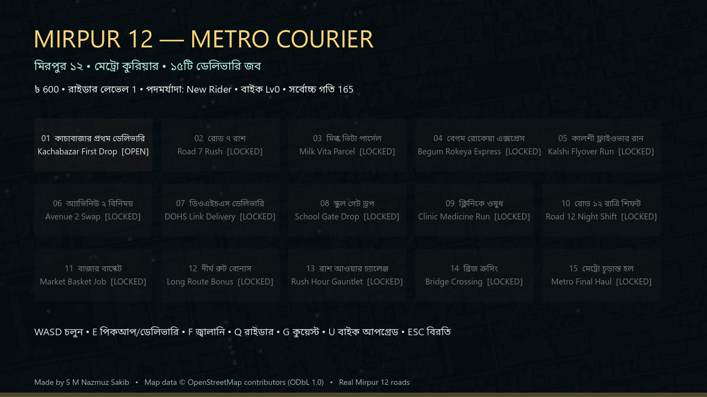
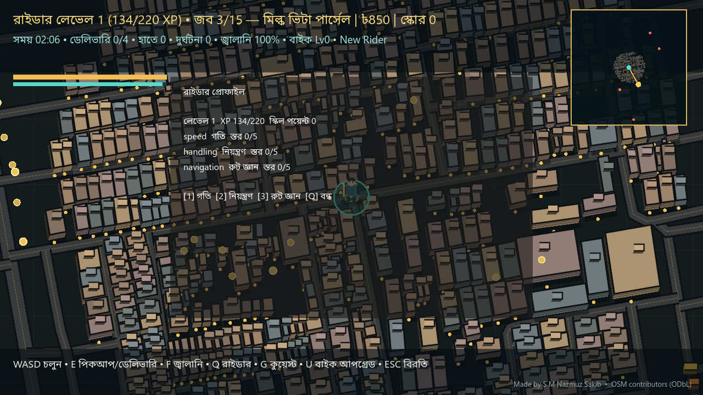
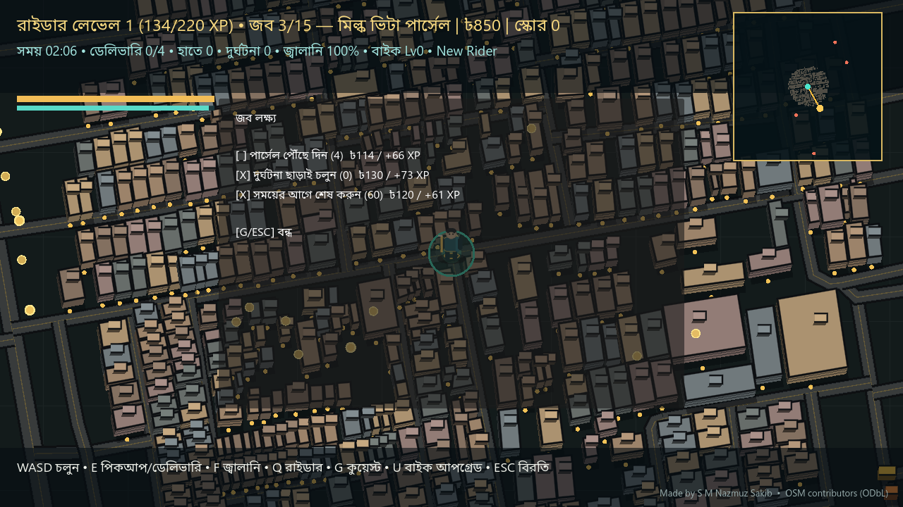
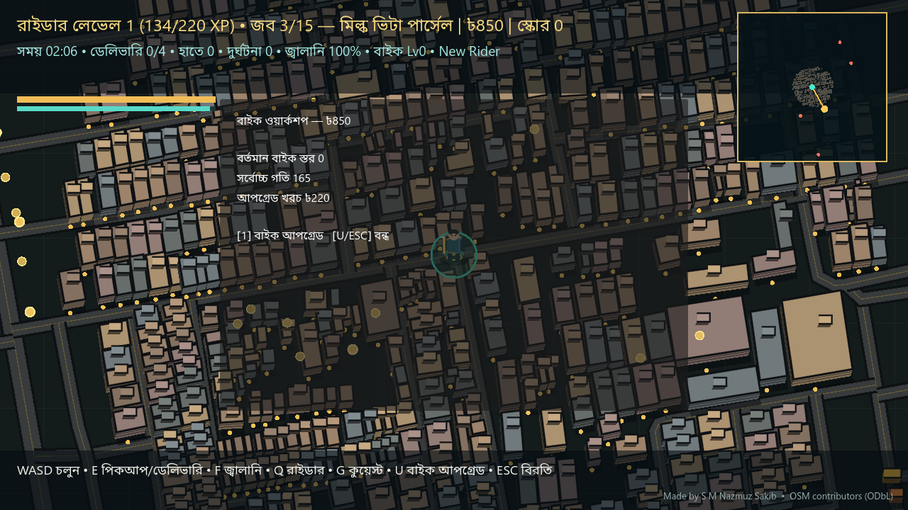
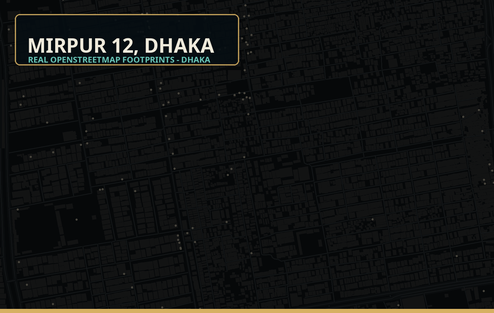
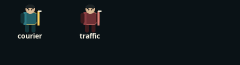

# Mirpur 12 — Metro Courier

[](https://github.com/Sakibpedia/mirpur12-metro-courier/actions/workflows/build_exes.yml)



A **2.5D timed-delivery game** on the real streets of Mirpur 12, Dhaka. Pick up parcels, beat traffic and the clock, upgrade your bike and finish 15 courier jobs. Godot 4.3.



## Play

Download `Mirpur12Courier.exe` from the [Releases page](https://github.com/Sakibpedia/mirpur12-metro-courier/releases) and double-click it. If SmartScreen warns, choose **More info → Run anyway** (unsigned build).

## Real urban data

The city is generated from an OpenStreetMap extract of Mirpur 12 (23.8154–23.8354 N, 90.3597–90.3797 E):

- **764 real roads** (150 named) — Begum Rokeya Sarani, Kachabazar Road, Milk Vita Road, Arambag Main Road, Kalshi Flyover, Road 1–12, Avenue 2 and the numbered lanes.
- **20,025 building footprints** (1,500 nearest used for collision, 600 drawn for GPU efficiency).
- **1,098 amenities**; shops and pickup points are placed along named roads.
- Moving traffic drives along the same real road network.

Regenerate: `python tools/build_mirpur_map.py`.

## Gameplay

- **15 courier jobs** with pickups, timed deliveries, traffic density and rewards.
- **Traffic** moves on real roads; collisions cost time and score (reduced by the handling skill).
- **Fuel** drains as you ride; `F` refuels for ৳40.
- **Bike upgrades** (5 levels) raise top speed.
- **Rider RPG**: XP, levels, skill points and three skills — speed, handling, navigation (extra time).
- **Three quests per job** plus grades, unlocks and persistent saves in `user://mirpur12_courier.cfg`.

## Screenshots (rendered from the running game)

| Job select | Delivery run | Rider skills |
|---|---|---|
|  |  |  |

| Quests | Bike upgrade | Summary |
|---|---|---|
|  |  |  |

| Real OSM map | Sprites |
|---|---|
|  |  |

## Controls

```
WASD / arrows ride    Shift boost    E pickup / deliver    F refuel
Q rider skills        G quests       U bike upgrade        ESC pause / close
Summary: R retry, N next job, M menu
```

## Build and test

```powershell
python tools/build_mirpur_map.py
python tools/make_visuals.py
godot --headless --path . --import
godot --headless --path . res://tools/test/CityTest.tscn
godot --headless --path . res://tools/test/EconomyTest.tscn
powershell tools/test/run_all.ps1 -Godot "C:\path\to\Godot_v4.3-stable_win64_console.exe"
godot --headless --path . --export-release "Windows Desktop"
```

Every suite prints `PASS`. Results: [docs/VERIFICATION.md](docs/VERIFICATION.md).

## Credits

**Made by S M Nazmuz Sakib.** Game design, code and generated art are by S M Nazmuz Sakib.
Map data © [OpenStreetMap contributors](https://www.openstreetmap.org/copyright), ODbL 1.0.
Fonts: Noto Sans / Noto Sans Bengali (SIL OFL 1.1).
No open-source license is granted for the original work.
